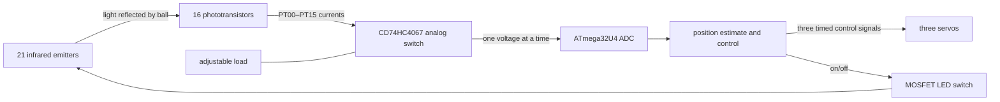

# BaBot electronics: learn the original design

This guide explains the *manufactured original* BaBot Base and Plate as a system. Its purpose is to show why each circuit exists and how its behavior follows from electrical and optical principles. The reconstructed connectivity comes from the [archived PCBWay Base and Plate files](../original/pcbway/), their manufacturing BOMs and flying-probe data, the [original schematic](../original/schematics/schematics_iNWgbALrz5.pdf), and the [published sketch](../original/upstream/BABOT-main/main.ino). The old schematic and manufacturing BOM disagree on some values; this guide identifies the manufactured BOM value when that matters. The editable upstream PCB was not available, so a signal path inferred from manufacturing data is labeled as such.

## Start with the problem, then the blocks

The robot must observe a ball's position without touching it, decide how the platform should tilt, and make three servos tilt it. That creates three different electrical jobs: **sense** reflected light, **compute** an error and motion command, and **deliver power** to the emitters and servos. Keeping these jobs distinct helps explain the entire schematic.

This is a **4 × 4 receiver grid**, surrounded by **21 emitters**. There is no image sensor. The position estimate comes from how strongly each receiver sees light reflected from the ball.

## 1. Make a controlled source of light

The Plate's `IR1`–`IR21` are Everlight IR204/H60 infrared LEDs. An LED emits light when current flows in its forward direction. Here each branch is `5 V emitter rail → its own resistor R1–R21 → IR LED → shared cathode bus → Q17 MOSFET → ground`. Each resistor is **330 Ω in the original manufacturing BOM**. The older schematic shows a different value, so use the BOM if you are studying the actually supplied fabrication files. The emitter is specified around 940 nm; a suitable infrared receiver can detect it even though human eyes cannot. See the [Everlight datasheet](https://en.everlight.com/wp-content/plugins/ItemRelationship/product_files/pdf/IR204-H60.pdf).

Why one resistor per LED? LEDs do not share current evenly when simply paralleled: a small difference in forward voltage makes one branch take more current, heat up, and take still more. A resistor in **each** branch adds negative feedback. As branch current increases, its resistor drops more voltage, opposing the increase. Using a rough 1.2 V LED drop and 0.1 V switch drop, the estimated branch current is `(5 − 1.2 − 0.1) / 330 ≈ 11 mA`; 21 lit emitters would then draw about **0.24 A**. A branch resistor would dissipate roughly `I²R ≈ 0.04 W`. These are design estimates, not measured currents; forward voltage, supply voltage, and switch drop vary.

`Q17` is an AO3400A N-channel MOSFET. It sits **below** the LEDs, so it is a low-side switch. A high gate voltage creates a conductive channel from drain to source and completes all 21 branches; a low gate voltage stops them. The microcontroller pin charges the gate capacitance, while the power supply and Q17 carry the LED current. `R22`, a 10 kΩ gate-to-ground resistor, holds the switch off when the controller is resetting or disconnected. This avoids an unpredictable floating gate. The MOSFET is a switch here, not an amplifier or a current regulator. [AO3400A manufacturer datasheet](https://www.aosmd.com/res/data_sheets/AO3400A.pdf).

**Design lesson:** Start with the optical power needed, then choose a safe LED current and resistor from voltage *limits*, not only a typical value. Size the switch, supply, connector, copper, and ground return for the *sum* of branch currents.

## 2. Turn reflected light into an electrical quantity

`Q1`–`Q16` are 1540031NC6090 phototransistors. A photon absorbed in the device creates charge carriers; transistor action lets a light-dependent collector-emitter current flow. More reflected infrared generally means more current, subject to distance, angle, ambient illumination, and saturation. The receiver is sensitive near the emitters' 940 nm wavelength. Its case and viewing angle also shape what part of the plate it sees. [Würth receiver datasheet](https://www.we-online.com/components/products/datasheet/1540031NC6090.pdf).

The manufacturing net data connect each receiver's collector to the logic 5 V rail and its emitter to one unique `PT00`–`PT15` wire. The Plate does **not** have sixteen individual load resistors. The selected receiver is instead loaded on the Base after the multiplexer. This is the key to the circuit: a phototransistor supplies a light-dependent current, but the ADC requires a voltage. Current through an effective resistance gives a voltage: approximately `Vsignal ≈ Iphoto × Rload` while the transistor and load remain in their usable ranges. For example, 10 µA through 10 kΩ would produce about 0.1 V; 100 µA would produce about 1 V. Those currents are illustrative, not measurements of this robot. The exact node voltage also depends on the phototransistor, multiplexer resistance, and ADC loading.

Why sixteen sensors? A single light reading cannot say where the ball is. A grid supplies a spatial pattern. With a reflective ball over one region, nearby receivers tend to respond more strongly than distant ones. The software can then compute a weighted center of that pattern. Optical overlap is useful: if only one sensor ever responded at a time, the position estimate would jump from cell to cell.

## 3. Share one ADC among sixteen analog signals

`U1` on the Base is a bare `CD74HC4067SM96` 16-channel **analog multiplexer**. It is a set of electronically controlled switches, not an ADC. Four digital address lines (`S0`–`S3`) select one of sixteen `PTxx` inputs and connect it to `U1_SIG`; the ATmega32U4 reads that common node at analog input `A0`. For example, binary address `0000` selects channel 0 and `1111` selects channel 15. Its enable input is active-low; `R1` (10 kΩ to ground) normally keeps the channels available. A high enable disconnects all channels. [TI CD74HC4067 datasheet](https://www.ti.com/lit/ds/symlink/cd74hc4067.pdf).

Why multiplex? It saves fifteen MCU ADC connections while retaining all sixteen sensor wires. The price is time: the controller must select and measure channels sequentially, and only one shares the load at a time. Switching also disturbs the common node because the old channel, new source, trace capacitance, and ADC sampling capacitor can have different voltages. The published sketch waits **600 µs after each channel selection** before calling `analogRead()`. That delay is there to let the analog node settle; the correct delay for a redesign should be checked with the actual source resistance, cable, and ADC behavior.

An analog switch has finite on-resistance, leakage, capacitance, and voltage limits. It cannot measure a signal outside its supply rails. If a channel is noisy or always reads like the preceding channel, suspect settling and source impedance before assuming the digital address is wrong.

## 4. Why the original board has an adjustable resistance

The original manufactured `U2` is a **bare TPL0501-100 digital-potentiometer IC**, not a Mikroe DIGI POT 2 module. Its `H` terminal reaches `U1_SIG` through `R18`; its wiper `W` and `L` end are connected to ground in the reconstructed manufacturing netlist. `R18` is **500 Ω in the original manufacturing BOM**, although the older schematic shows a different value. The resulting circuit is a variable **shunt/load to ground**: approximately `Rload = R18 + RH–W`. `R18` keeps some series resistance even when the adjustable portion is near zero. The TPL0501-100 is nominally **100 kΩ end to end**, with 256 selectable taps; 10 kΩ is a possible working adjustment, not the part's nominal resistance. [TI TPL0501-100 datasheet](https://www.ti.com/lit/ds/symlink/tpl0501-100.pdf).

Why adjust it? For a given photocurrent, a larger load produces a larger ADC voltage. That can make weak reflections easier to distinguish, but an excessively large load can push bright readings toward the 5 V ceiling and make the node slower to settle. A smaller load is less sensitive and faster, but may leave too little difference between ball and background. The desired setting is where dark, ambient, and ball-reflection readings remain separable *without clipping*. It should be found by measurement.

The TPL0501 has `CS`, `DIN`, and `SCLK` control connections in the original board net data. However, the [available published `main.ino`](../original/upstream/BABOT-main/main.ino) does **not** contain TPL0501 or SPI setup/writes. Therefore this archive does not establish a deliberate startup tap or show that software adjusted it in use. Its physical loading role is supported by the board connectivity; its operating tap in an actual original build is unverified. Do not assume that editing a constant in the archived sketch controls U2.

## 5. Reject steady room light by measuring twice

The MCU first turns the emitters **off** and reads all sixteen sensors: this is the ambient/background set. It then turns the emitters **on**, reads all sixteen again, and subtracts `off` from `on` channel by channel. If room illumination stays nearly constant over the two scans, much of it cancels. The useful signal is the change caused by the robot's own infrared source and the ball's reflection. The sketch smooths these differences, checks whether the spatial range suggests a ball, and computes a weighted center.

This is the circuit reason for having a controllable MOSFET rather than leaving the IR LEDs permanently on. Subtraction cannot repair a saturated ADC, a receiver pointed the wrong way, or a rapidly flickering external IR source. The optical and electrical design must first keep readings in a useful range.

## 6. Turn a position estimate into movement

Original `U4` is a bare ATmega32U4-AU. It samples the mux output, reads `SW1`, computes the position error and controller output, and generates three servo command pulse trains. A servo connector has **signal, 5 V, and ground**; the signal pin only commands position. Motor current flows through the supply and ground, not through the MCU pin. The sketch uses a PID controller and mechanism geometry to convert X/Y error into three servo angles. Those algorithms are for the later software guide; electrically, the important point is that a sensor change becomes a timed command, while the power rail supplies the motion energy.

The Base includes several small circuits that make the MCU dependable:

| Part or group | Why it is present |
| --- | --- |
| `U9` 16 MHz crystal, `U8`/`U10` 22 pF | Give the bare MCU a stable clock and the crystal its intended load. A clock is required for instruction timing, USB, and repeatable sampling. |
| `C1` 220 nF, `C2`–`C4` 1 µF | Local charge and filtering. The AREF and UCAP connections have MCU-specific roles; they are not interchangeable with a random bulk capacitor. |
| `R6` 10 kΩ | Holds reset high in normal operation; reset is asserted by pulling it low. |
| `SW1`, `R7` 10 kΩ | Pressing SW1 drives the button input high. R7 defines a low level when released so the input does not float. |
| `U14`/`U15` LEDs, `R10`/`R11` | Power/status indication; the resistors limit LED current. The manufacturing BOM lists the resistors as 500 Ω. |
| `H4`/`H5` | Programming connections for the bare MCU. |

The original Base also has two USB-C connectors, four 5.1 kΩ CC pull-downs (`R14`–`R17`), SS24AF Schottky diodes (`U20`/`U21`), and solder bridges (`U22`–`U26`). The CC pull-downs tell a USB-C source that a sink is attached; the diodes and configurable bridges steer or isolate the available power/data paths. The original high-current net is named `VCC-5V-2A`, but a net name is **not** a verified 2 A capability. Three servo current peaks and the LED bank determine what the source and copper actually need. `C5` (10 µF) offers a small local charge reserve on that rail; it cannot compensate for an undersized supply.

## Recreate the design reasoning yourself

1. Define the measurable quantity: which receiver currents change when the ball moves, and what dark/bright range should the ADC see?
2. Choose LED current from optical need, then solve `R = (Vsupply − VLED − Vswitch) / ILED` and check resistor power and total array current.
3. Choose a load that turns expected photocurrent into a useful, unsaturated ADC voltage. Test the extreme cases, not just the middle of the plate.
4. Check mux and ADC settling after every channel switch. A shared load saves parts but means channels interact through one analog node over time.
5. Separate the high-current LED/servo loops from the analog return path as far as practical. Voltage drop in a shared ground trace becomes measurement error.
6. Verify the *whole chain*: IR off/on readings → spatial response → estimated position → servo pulse → mechanical tilt. A pin map alone cannot prove that a sensor system works.

The [current THT/module redesign](electronics_tht.md) keeps this measurement and control concept but changes how several blocks are packaged and powered.
