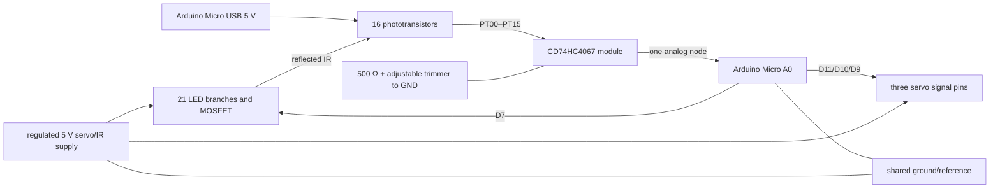

# BaBot electronics: learn the current THT/module design

Read the [original-circuit guide](electronics_original.md) first if this is your first time with the project. The current design keeps the same optical measurement and three-servo control idea, but makes the carrier PCBs hand-solderable: through-hole components and headers replace many small surface-mount parts, and two preassembled modules supply the difficult IC circuitry. This guide follows the **current KiCad schematics and BOMs** in [`PCB/KiCad/`](../PCB/KiCad/). The Base is a completed **four-layer** layout. The Plate schematic and older two-layer KiCad PCB document the THT circuit; the newly supplied routed Plate Gerbers cannot yet be checked against their editable source (see the [fabrication review](../PCB/fabrication/plate/REVIEW_NOTES.md)). Circuit intent is not a claim that a physical build has been tested.

## The complete cause-and-effect chain



The 20-way Base–Plate cable carries **sixteen sensor signals, LED control, servo/IR 5 V, logic 5 V, and ground**. The first sixteen positions are `PT00`–`PT15`, followed by `IR_LED_CONTROL`, `+5V_SERVO`, `+5V_LOGIC`, and `GND` at pins 17–20. This is the intended pin map in the current [Base connection table](../PCB/KiCad/BaBot_Base_THT_4067_Module_connections.csv) and [Plate connection table](../PCB/KiCad/BaBot_Plate_THT_connections.csv). A straight-through cable must preserve pin 1 at both ends. A reversed ribbon can put power on a sensor or control pin, so continuity-check it before joining the boards.

## 1. Power: why there are two 5 V nets and one ground

The Base `U4` is a complete [Arduino Micro](https://docs.arduino.cc/hardware/micro/) module. Its USB input supplies `+5V_LOGIC` to the Micro, the CD74HC4067 module, and the Plate's phototransistors. Base `J1` accepts an **external regulated 5 V** supply for `+5V_SERVO`, which feeds three servo headers and the Plate's 21 emitter branches. The positive rails are separate in the current design, while grounds meet. The two supplies need the same **0 V reference**: an MCU's “5 V gate high” and a servo's control pulse have meaning only relative to the receiving circuit's ground.

Why separate positive feeds? Servos draw current in bursts as they accelerate or resist load. A wire or trace has resistance and inductance; a burst creates voltage drop and transient noise. If that disturbance reaches the ADC reference or phototransistor feed, a stationary ball can appear to move. A separate power feed reduces this coupling. It does not remove every shared-ground effect, so route the high-current return with care and test under servo load.

`C5` is a 10 µF electrolytic across the servo rail near the Base power path. It supplies a *small* local charge reserve for rapid changes. `C1` is a 220 nF ceramic bypass capacitor for the logic/mux side; its short connections give high-frequency noise a local return path. The Arduino Micro already contains its own clock, USB, and support circuitry. These capacitors have different jobs, and neither makes an insufficient external supply adequate. The original bare-MCU USB-C, crystal, programming, and diode network is no longer populated on the THT Base.

The four-layer Base uses an inner copper plane for the servo rail. Its existing design assumed **2 A total** for that path; that is a routing assumption, not a measured guarantee for three SG90 or MG995 servos at stall. Motor selection, simultaneous loading, connector rating, temperature rise, copper weight, and the ground return must be checked before treating the board as fully qualified. The Plate's LED bank is about 0.24 A by the nominal resistor estimate below, adding to the external supply load when lit.

## 2. The Arduino Micro is a functional block, not just an IC adapter

In the original Base, the designer had to place and connect an ATmega32U4, crystal, load capacitors, USB connector, reset support, and programming paths. The assembled Arduino Micro already includes these subsystems and exposes usable pins on 2.54 mm headers. It is still the same *kind* of controller: it reads a 5 V-domain analog signal, addresses the mux, switches the emitter bank, and generates servo command pulses. The module choice reduces fine-pitch assembly work, but increases board height and requires correct header orientation. The [Arduino Micro schematic](https://docs.arduino.cc/resources/schematics/A000053-schematics.pdf) shows what is already on the module.

The pushbutton `SW1` applies `+5V_LOGIC` to the button input when pressed; `R7` (10 kΩ) pulls it to ground when released. That pull-down makes the idle state a definite logic 0. `U15` is the software-controlled status LED and `R10` (500 Ω) limits its current; without a resistor, the LED's steep voltage–current characteristic could overload the output. The current module also has its own board-level indicator, but U15 is a separate user-visible signal.

Each servo header `H1`–`H3` has a control signal, external 5 V, and ground. The controller pin provides timing, **not motor power**. Thus a thin signal route may work electrically while the supply and ground paths need far greater current capacity. The published sketch is currently copied unchanged into [`software/main.ino`](../software/main.ino); its pin assignments match the intended Micro connections, but this guide does not teach the software algorithm yet.

## 3. Why the 4067 is still required even as a module

The Base `U1` is a preassembled CD74HC4067 breakout on through-hole headers. Its chip still provides sixteen analog switches selected by four address bits. The Plate supplies `PT00`–`PT15`; the shared `U1_SIG` node goes to Micro `A0`. The Micro chooses channel 0 through 15, waits for the voltage to settle, and samples. `R1` (10 kΩ) holds the module's active-low enable input low, so a floating MCU pin during reset does not disable the sensor bank. See the [TI CD74HC4067 datasheet](https://www.ti.com/lit/ds/symlink/cd74hc4067.pdf).

Why use the chip rather than sixteen digital input pins? A phototransistor's output is analog: intensity matters, not only “light/no light.” The mux passes that analog voltage to one ADC input. The module changes **assembly**, not the measurement principle. A generic breakout's header order is not guaranteed by the chip number, however. Compare the purchased module's actual labels and orientation with the [`U1` footprint](../PCB/KiCad/BaBot_THT.pretty/CD74HC4067_Module.kicad_mod) before insertion. If the physical module differs, the PCB's schematic pin mapping alone cannot make it work.

Multiplexing interacts with the shared sensor load. The common node must settle after every channel selection; higher resistance and longer cable capacitance can require more time. The current published sketch allows 600 µs between selection and ADC conversion. That is a starting observation from the source, not proof of adequate settling on every assembled module.

## 4. The trimmer replaces the digital potentiometer's *electrical job*

Base `RV1` is a **Bourns 3296W-1-104LF, 100 kΩ, 25-turn** through-hole trimmer. `R18` (500 Ω) connects `U1_SIG` to trimmer end 1; its wiper (pin 2) and far end (pin 3) both go to ground. This creates an adjustable load to ground:

```text
selected phototransistor → CD74HC4067 → U1_SIG → R18 500 Ω → RV1 adjustable part → GND
                                         │
                                         └─────────────── Arduino Micro A0
```

At any one trimmer setting the node behaves roughly as `Vsignal ≈ Iphoto × (500 Ω + Rtrim)` until the phototransistor or ADC approaches a limit. The approximation is useful for choosing a starting range, but the real response includes the phototransistor's collector-emitter voltage, the mux's on-resistance, cable capacitance, and the ADC input. A nominal 100 kΩ trimmer is not intended to be left at 100 kΩ automatically. **About 10 kΩ from RV1 pin 1 to ground, measured with power off, is only an initial setting**; the useful value must come from IR-off/IR-on ADC measurements at the actual ball height and lighting. The 25-turn adjustment is reversible and gives finer control than a single-turn part. [Bourns 3296 datasheet](https://www.bourns.com/docs/product-datasheets/3296.pdf).

Why ground both wiper and end 3? If the moving wiper briefly loses contact, end 3 remains a conductive route to ground through the full resistance element, rather than leaving the analog load open. Why retain R18? It prevents the adjustable branch from becoming a near-short at one end of travel and preserves a finite minimum load. As load resistance rises, a small photocurrent produces a bigger voltage, but bright readings may saturate and high source impedance slows settling. This is an **analog sensitivity control**, not a required code constant.

The archived upstream sketch does not issue digital-pot commands. Replacing the original bare TPL0501 with a trimmer therefore did not require removing a command from the current [`main.ino`](../software/main.ino). If tuning changes ADC amplitude enough, the ball-detection threshold or other software calibration may eventually need adjustment, based on measured readings. Changing a number in code cannot set RV1's resistance; turn the trimmer to do that.

## 5. The THT Plate creates light and detects its reflection

The Plate still uses 21 IR204/H60 infrared LEDs and sixteen 1540031NC6090 phototransistors in the original optical arrangement. Each LED has its own **330 Ω axial resistor**. With a nominal 5 V supply, 1.2 V LED drop, and 0.1 V switch drop, a branch is near 11 mA and all 21 lit branches are near 0.24 A. The 0.25 W resistor rating in the [current Plate BOM](../PCB/KiCad/BaBot_Plate_THT_BOM.csv) exceeds the roughly 0.04 W nominal branch dissipation. Real currents still depend on actual parts and supply. The emitters and receivers remain through-hole optical parts, while the original tiny LED resistors become axial parts on the board underside. [Everlight IR204/H60 datasheet](https://en.everlight.com/wp-content/plugins/ItemRelationship/product_files/pdf/IR204-H60.pdf); [Würth receiver datasheet](https://www.we-online.com/components/products/datasheet/1540031NC6090.pdf).

Each receiver collector is fed by `+5V_LOGIC`; each emitter leaves as its own PT channel. The Base's selected-channel load converts light-driven current into a voltage. This choice saves sixteen Plate resistors but makes the Base trimmer, multiplexer, and ADC input part of the sensor circuit. If you inspect the Plate in isolation and wonder why a PT wire has no local pull resistor, follow that wire through the 20-way cable to `U1_SIG` and the trimmer.

Plate `Q17` is now an **FQP30N06L TO-220** logic-level N-MOSFET. The path remains `+5V_SERVO → 330 Ω → LED → Q17 drain → Q17 source → ground`. `R22` (10 kΩ) pulls the gate low so the emitters stay off during startup. The new `R23` (220 Ω) is between the MCU's `IR_LED_CONTROL` output and the gate. It limits the brief gate-charging pulse and can damp ringing from trace/cable inductance. Gate current is transient; normal LED current runs through the MOSFET drain-source path. The [onsemi datasheet](https://www.onsemi.com/download/data-sheet/pdf/fqp30n06l-d.pdf) specifies on-resistance at a 5 V gate drive, so checking only its threshold voltage is unnecessary and misleading. The exact purchased part must match the footprint's **gate–drain–source** pin order; the metal tab is electrically connected to drain.

The controller turns this switch off for an ambient scan and on for an illuminated scan. Subtracting the two readings suppresses steady background light, revealing reflection from the robot's own LEDs. With a bright ball, nearby cells in the 4 × 4 array should form a peak. If that peak is absent, the failure could be optical alignment, emitter polarity, transistor polarity, connector orientation, signal loading, or power integrity; the pin map alone cannot identify it.

## 6. Why the physical PCB details matter to the circuit

The Base's high-current path is routed separately from the mux-to-ADC analog path. The Plate's emitter branches switch together, so their shared cathode and ground return carry a current step each time Q17 changes state. Any resistance in a shared return turns that current step into a local ground shift (`ΔV = I × R`), which can contaminate the receiver voltage. Copper width and placement are therefore part of measurement quality, not only a heating concern.

The THT Plate uses a **2 × 10, 2.54 mm header on its underside** instead of the original 0.5 mm FPC socket. That makes hand assembly easier but adds height and creates a cable-orientation hazard. Test pin 1, all power pins, and ground before connecting the Base. Use the [connection tables](../PCB/KiCad/) and actual connector keying rather than assuming that two 20-pin parts face the same direction.

There is also a difference between a sound *circuit* and a manufacturable *Gerber export*. The supplied routed Plate ZIP has F.Mask and B.Mask filenames, but both files contain only headers and no drawn pad openings; it also contains no drill files. The older unrouted Plate PCB stored THT pads on `*.Cu` without `*.Mask`, a likely explanation for the empty export, but the routed source board is needed to confirm and repair it. See the [Plate fabrication review](../PCB/fabrication/plate/REVIEW_NOTES.md). Do not order the current ZIP as a finished THT board.

## A practical experiment to prove each design choice

1. Before connecting modules, check rail isolation with power off: `+5V_LOGIC` should not be shorted to `+5V_SERVO`; both circuits must share ground.
2. Power the Micro and external 5 V source with a current limit. Verify the Plate's LED rail, logic rail, and MOSFET gate at rest. The emitter bank should be off while the controller pin is inactive.
3. Set RV1 to about 10 kΩ with power off. Read one PT channel in darkness, with room light, and with LEDs on. Repeat with the ball over that cell. A useful signal changes with the ball but does not stick at an ADC rail.
4. Scan all sixteen channels and move the ball across the plate. The maximum or weighted center should move in the same physical direction. If it mirrors or scrambles, inspect header orientation and channel mapping.
5. Turn on servo motion and watch whether sensor readings shift without moving the ball. That reveals power/ground coupling and tells you whether supply or return routing needs work.
6. Only after the electrical chain behaves, tune ball-detection and control software. That keeps an analog hardware problem from being hidden by a code change.

The goal of each check is to prove a *reason*: the resistors set LED current, the MOSFET lets the controller modulate illumination, the phototransistors turn reflection into current, the shared load turns current into voltage, the mux shares one ADC, and the separate supply keeps servo energy out of the sensing rail.
